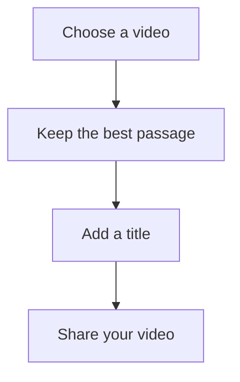
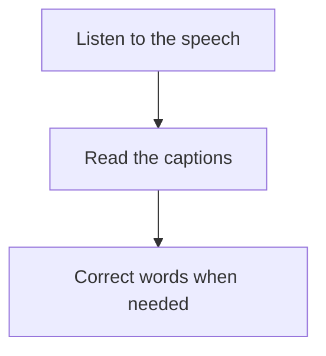

# Your first video

Turn a memory into a short video, add a title and share the result. Follow the steps at your own pace and return to editing at any time with **Close**.

You need a video in Photos. Music and captions are optional: feel free to skip those steps.

## 1. Choose your video

1. From the library, tap **New project**.
2. Open **Media → Photos and videos**.
3. Select a video you like and confirm.
4. Choose **At the end of the edit** in the import list and tap **Add**.

Your video should appear in the preview, with a rectangle in the timeline below it. Tap **Play** to watch it.

No video handy? Open the sample project from the library to try the tools.

## 2. Keep the best passage

1. Tap your video in the timeline to highlight its edges.
2. Drag its start handle to remove the wait before the action.
3. Drag its end handle to stop at the right moment.
4. Tap **Play** and listen to the result.

Aim to start with the interesting moment and end without dragging on.

If handles are too close, tap the **+** zoom button. Made a mistake? Tap **Undo** at the top.

## 3. Add a title

1. Tap an empty area of the timeline to return to the add tools.
2. Choose **Text → Add text**.
3. Select the text, tap **Edit** and enter a title such as “A happy memory”.
4. Tap **Done** to dismiss the keyboard.
5. Under **Style**, choose a readable color and adjust size using **−** and **+**.
6. Select the title in the preview and drag it where you want.

Replay the beginning: your title should be visible without hiding the subject. Shorten its timeline segment to make it disappear after a few seconds.

For a little character, try another **Font** or a colored background under **Style**.

## 4. Adjust the sound

Tap the video in the timeline and open **Volume**. Listen and adjust it to a comfortable level.

Want music? This part is optional.

1. Return to the add tools and open **Audio → Import audio**.
2. Choose a music file in Files and confirm adding it.
3. Select the sound and lower its **Volume** if your video contains speech.
4. Adjust duration using the handles and add a **Fade** at the end.

Speech should remain clear. Without music to add, keep the original sound and continue.

## 5. Add captions if someone speaks

Skip this step if your video has no speech.

1. Open **Text → Auto captions**.
2. Choose your video and its spoken language.
3. Tap **Generate captions** and wait.
4. Play the video and follow the text.
5. To correct a word, select its caption, tap **Edit**, choose its row and save the correction.

Choose **Entire track** to move all captions or give them the same style. Return to **This caption** to change just one line.

## 6. Share your video

1. Tap **Export** at the top.
2. Choose portrait **9:16**, square **1:1** or landscape **16:9**.
3. Start with **Balanced**, **1080p** and H.264.
4. Tap **Start export** and wait for completion.
5. Watch the exported video, then tap **Share** or **Save to Photos**.

Before sharing, check your title, the ending of the sound and captions. If you change format, check that the subject and text stay inside the frame.

Your first video is ready. Use **Export complete project** too for a copy you can transfer and edit later.

Want to explore further? The **Help** tab explains effects, animations, voiceovers and different formats.
