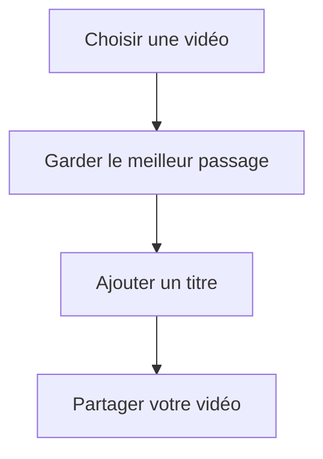
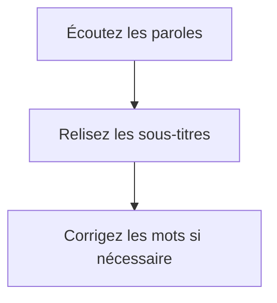

# Votre première vidéo

Créez une courte vidéo à partir d’un souvenir, ajoutez un titre et partagez le résultat. Avancez à votre rythme et retrouvez le montage à tout moment avec **Fermer**.

Il vous faut une vidéo dans Photos. La musique et les sous-titres sont facultatifs : vous pouvez passer ces étapes.

## 1. Choisissez votre vidéo

1. Depuis la bibliothèque, touchez **Nouveau projet**.
2. Ouvrez **Médias → Photos et vidéos**.
3. Sélectionnez une vidéo que vous aimez, puis confirmez.
4. Dans la liste d’import, choisissez **À la suite du montage** et touchez **Ajouter**.

Vous devez voir votre vidéo dans l’aperçu et un rectangle dans la timeline, juste en dessous. Touchez **Lire** pour la regarder.

Pas de vidéo sous la main ? Ouvrez le projet exemple depuis la bibliothèque pour essayer les outils.

## 2. Gardez le meilleur passage

1. Touchez votre vidéo dans la timeline : ses bords sont mis en évidence.
2. Faites glisser sa poignée de début pour retirer l’attente avant l’action.
3. Faites glisser sa poignée de fin pour arrêter la vidéo au bon moment.
4. Touchez **Lire** et écoutez le résultat.

L’objectif : commencer directement sur le moment intéressant et terminer sans longueur.

Si les poignées sont trop proches, touchez le bouton **+** de zoom. Une mauvaise manipulation ? La flèche **Annuler**, en haut, permet de revenir en arrière.

## 3. Ajoutez un titre

1. Touchez une zone vide de la timeline pour retrouver les outils d’ajout.
2. Choisissez **Texte → Ajouter du texte**.
3. Sélectionnez le texte, touchez **Modifier** et écrivez un titre, par exemple « Un beau souvenir ».
4. Touchez **Terminé** pour fermer le clavier.
5. Dans **Style**, choisissez une couleur lisible et ajustez la taille avec **−** et **+**.
6. Sélectionnez le titre dans l’aperçu et faites-le glisser où vous le souhaitez.

Relisez le début : le titre doit être visible sans cacher le sujet. Vous pouvez raccourcir son segment dans la timeline pour qu’il disparaisse après quelques secondes.

Pour un peu de fantaisie, essayez une autre **Police** ou un fond coloré dans **Style**.

## 4. Réglez le son

Touchez la vidéo dans la timeline, puis **Volume**. Écoutez et ajustez le niveau pour que le son soit agréable.

Envie de musique ? Cette partie est facultative.

1. Retrouvez les outils d’ajout et ouvrez **Audio → Importer un audio**.
2. Choisissez un fichier musical dans Fichiers et confirmez son ajout.
3. Sélectionnez le son et baissez son **Volume** si la vidéo contient des paroles.
4. Ajustez sa durée avec les poignées et ajoutez un **Fondu** à la fin.

Vous devez entendre les paroles clairement. Sans musique à ajouter, gardez simplement le son d’origine et passez à l’étape suivante.

## 5. Ajoutez des sous-titres si quelqu’un parle

Passez cette étape si votre vidéo ne contient pas de paroles.

1. Ouvrez **Texte → Sous-titres automatiques**.
2. Choisissez votre vidéo et la langue parlée.
3. Touchez **Générer les sous-titres** et attendez.
4. Lisez la vidéo en suivant le texte.
5. Pour corriger un mot, sélectionnez son sous-titre, touchez **Modifier**, choisissez sa ligne et enregistrez la correction.

Pour déplacer tous les sous-titres ou leur donner le même style, choisissez **Toute la piste**. Revenez à **Ce sous-titre** pour ne modifier qu’une ligne.

## 6. Partagez votre vidéo

1. Touchez **Exporter** en haut.
2. Choisissez vertical **9:16**, carré **1:1** ou paysage **16:9**.
3. Pour commencer, choisissez **Équilibré**, **1080p** et H.264.
4. Touchez **Lancer l’export** et attendez **Terminé**.
5. Regardez la vidéo exportée, puis touchez **Partager** ou **Enregistrer dans Photos**.

Avant de partager, vérifiez le titre, la fin du son et les sous-titres. Si vous changez de format, vérifiez que le sujet et le texte restent dans le cadre.

Votre première vidéo est prête. Pour une copie que vous pourrez transférer et modifier plus tard, utilisez aussi **Exporter le projet complet**.

Envie d’aller plus loin ? L’onglet **Aide** explique les effets, les animations, la voix off et les différents formats.
