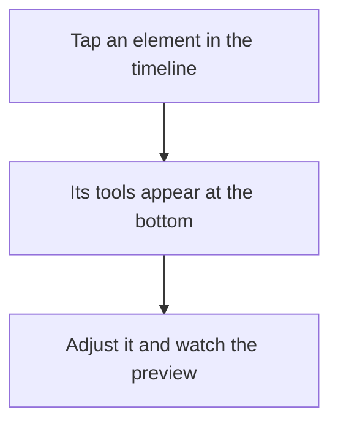
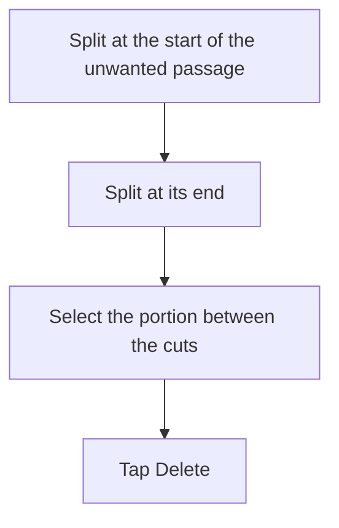
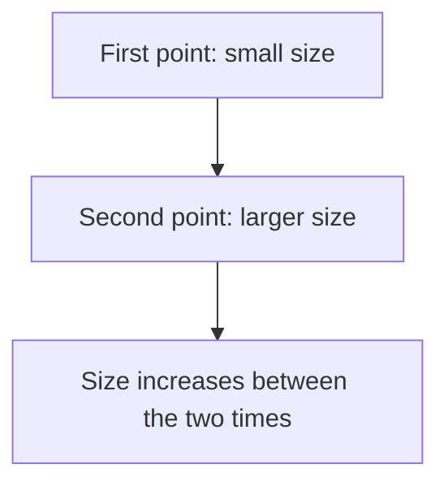
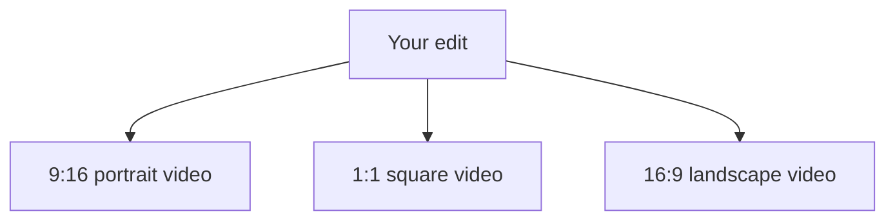

# Using CutFuze

Choose a topic to find the commands you need. Follow [first steps](Tutorial.en.md) to create your first video.

## How do I add my photos and videos?

1. In the library, tap **New project**.
2. In the editor, open **Media → Photos and videos**.
3. Choose your photos and videos and confirm.
4. Arrange them in the import list.
5. Choose **At the end of the edit**, then **Add**.

Your first shot appears in the preview. Other shots follow in the timeline, the editing area beneath the video.

For media in Files, choose **Media → Files**. **Local resources** lets you reuse media already added to the project.

Want an image on top of the video? Use **Overlay → Photos and videos** and the overlay destination. You need an active scene for this destination.

Media stored in iCloud may take time to download. Wait for import to finish before continuing.

## How do I find my way around the editor?

**At the top**, return to your projects, undo an action or export your video.

**In the preview**, see the result at the selected time. The playback button below plays your edit. The time display shows your current position.

**In the timeline**, rectangles represent videos, photos, text and sound. Scroll tracks to move forward or backward. The vertical line marks the instant shown in the preview: this is the playhead.

**At the bottom**, tools change to match your selection. Tap text for **Edit**, **Style** and **Font**; tap audio for **Volume** and **Fade**.

Need more room? Drag the small bar between the preview and timeline. Scroll tools sideways for more commands, and panels vertically for lower settings.

**Story** offers another way to organize scenes. Stay in the timeline for everyday editing if you prefer. Changes in either view appear in the other.

## How do I shorten or cut a video?

To keep the interesting passage:

1. Tap the video segment in the timeline.
2. Drag its start handle to the right.
3. Drag its end handle to the left.
4. Play the passage to check its boundaries.

If handles are hard to reach, enlarge the timeline with the **+** zoom button. You can extend the segment back to the original video's limits.

To cut in two, position the playhead, select the segment and tap **Split**. The playhead must be inside the segment, rather than exactly at its start or end.

To remove a passage in the middle:

Play the result. If a scene or other elements still occupy that time, adjust their positions or duration too. Deleting an element does not necessarily shorten every track.

Made a mistake? Tap **Undo** at the top.

## How do I move an element or change its duration?

Select a timeline segment and drag it to the desired time. Change duration with its start or end handle.

**Snapping** helps align elements with cuts or markers. Turn it off for free positioning. Zoom makes precise placement easier.

In the preview, **select the object first**, then drag the framed object. Frame controls adjust size and rotation. To resize text over a video, make sure the frame surrounds the text.

**Duplicate** creates another copy. The **red trash button** deletes it. To change a photo or video, use **Replace** or **More → Replace media**, depending on the tools shown.

## How do I frame and overlay images?

Select a shot and open **Effects → Transform**.

**Fit** shows the whole image. Bars may appear when its shape differs from the video. **Fill** covers the frame but may crop edges. Adjust position and scale to keep your subject visible.

Use **Opacity** for a partially transparent image, or **Mask** to show only part of it.

**Cutout** removes the background around a person on supported media. Inspect edges during playback, especially around hair and moving subjects.

For a graphic element, open **Overlay → Shape**, choose a shape and position it in the preview. Width and height can be adjusted separately.

## How do I add and style text?

1. Return to the add tools and open **Text → Add text**.
2. Select the new text and tap **Edit**.
3. Enter text and tap **Done** to dismiss the keyboard.
4. Open **Style** to adjust size, color, outline and background.
5. Open **Font** to choose another typeface.

Size is measured in points using **−** and **+**. To move or resize text in the video, select it in the preview before using its frame.

For a colored background, choose a color and increase its opacity. Options include rectangles, rounded shapes, pills, clouds, stars and hearts. Prefer a simple shape for several lines.

Tip: inspect text over several frames. Text readable on a dark image may disappear against a bright sky. An outline or background helps.

## How do I create and correct captions?

If your video contains speech:

1. Open **Text → Auto captions**.
2. Choose the video or audio to transcribe.
3. Select the language actually spoken.
4. Tap **Generate captions** and wait for them to appear.

You can choose another output language when translation is available. Menu language is separate from your video's language.

To correct a caption, select it and tap **Edit**. Choose its row, correct the text above and tap **Save**. **Style**, **Font** and **Effects** customize its appearance.

**This caption** applies compatible settings only to the selected segment. **Entire track** harmonizes styling or moves captions together. Switch back for an individual exception.

**Apple Intelligence proofreading** can suggest corrections. Choose a segment or the whole track, listen and check proposals before applying them. This checks writing, rather than whether words exactly match the voice. It requires a supported device with Apple Intelligence enabled.

Already have captions? Use **Text → Import SRT**.

## How do I add music or a voiceover?

Open **Audio → Import audio** and choose a file in Files. **Imported audio** retrieves sound already in the project.

Select sound to adjust **Volume**, **Speed** or **Fade**. Fades soften beginnings and endings. Speed also changes duration: check where sound starts and stops afterwards.

To record your voice:

1. Position the playhead and open **Audio → Voiceover**.
2. Allow microphone access if prompted.
3. Start recording and wait for the countdown.
4. Stop and choose **Use this recording**.

Use headphones if you listen to the edit while recording. To create speech from text, choose **Audio → Text-to-speech** and an available voice.

Listen and lower music if it covers speech. The volume curve under **Volume** lets you lower sound during speech and raise it afterwards.

## How do I animate text, pictures or sound?

Start with presets under **Animation**. **In** makes an element appear, **Out** makes it disappear and **Loop** repeats a movement.

For a custom movement, open the keyframe editor. A point sets a value at a time: for example a small size at the start and a larger size a second later. The curve shows the change between them.

1. Choose what to animate: position, size, rotation or opacity.
2. Choose a time, set its value and add a point.
3. Move forward, change the value and add another point.
4. Select the second point to choose how the movement arrives there.

**Interpolation** describes that progression: linear for regular change, acceleration or deceleration for softer movement. The first point has no arrival from an earlier point.

If nothing moves, check that points have different values. Drag the bar beneath the preview for more space. The same principle lets you vary audio volume.

## How do I add an effect and preview it?

1. Select the element to change.
2. Open **Effects** and choose beauty, geometry, creative or light treatments.
3. Choose an effect and adjust settings.
4. Play the sequence in its editor to see the result in motion.
5. Compare with the original and confirm.

Try **Neon** for a glowing outline, **Ghost trail** on a moving subject or **Stop motion** for stepped movement. **Time scan** progressively freezes the picture in your chosen direction.

For **Write-on**, open the drawing area. Lift your finger and resume elsewhere for separate strokes. Use **Clear** to start again and confirm when ready.

Under **Applied**, find effects, open settings, disable them temporarily or delete them with the red trash button. Browsing a category does not apply an effect by itself.

Can't see an effect? Check intensity and its active period. Some effects are more noticeable on moving video than on text or a photo. Several complex effects can slow playback.

## How do I change format and export?

Open **Format** in the add tools: **9:16** for portrait, **1:1** for square or **16:9** for landscape.

Editing and sound remain shared across formats. Adjust framing and text position for each output with format-specific settings. Check other outputs after changes.

1. Tap **Export** at the top.
2. Select the formats you want.
3. Start with **Balanced** and **1080p**. **Compact** makes a smaller file; **High fidelity** preserves more detail.
4. Choose H.264 for compatibility; HEVC generally makes smaller files.
5. Tap **Start export** and wait for completion.
6. Play the result before sharing or saving to Photos.

File size is an estimate. Increasing resolution cannot restore detail missing from a blurry source.

The device may continue processing in the background, but it can also interrupt it. Follow notices, keep CutFuze open when asked and avoid force-quitting during processing.

Choose **Export complete project** for a copy you can edit later or transfer. The exported video is for sharing; the project file preserves editing elements. **SRT** and **VTT** export captions separately.

## Need a hand?

**I can't find a tool.** Check the selected segment and scroll the bottom toolbar. Add tools appear when no segment is selected.

**The keyboard hides settings.** Tap **Done**, then scroll the panel.

**I can't see my text.** Check duration, position, color and opacity. Move the playhead to a time when text should appear.

**All captions are changing.** Choose **This caption** before editing one segment.

**I can't split.** Position the playhead inside the segment and tap **Split**.

**Captions won't generate.** Check for audible speech and the right language. Some features need resources the device must download.

**Export is slow.** Try lower resolution or fewer complex effects, check storage and follow the processing notice.
