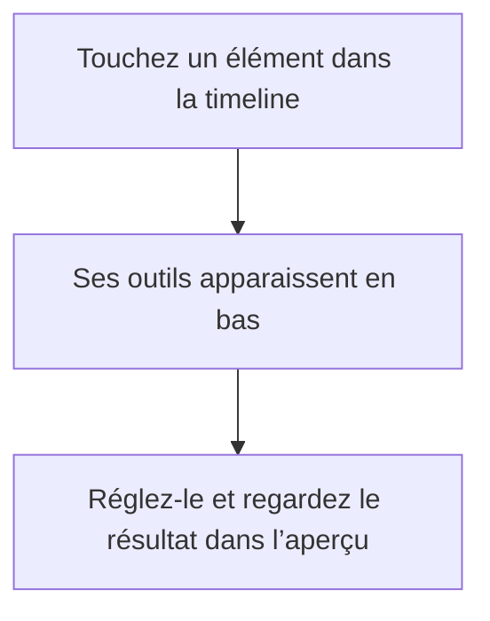
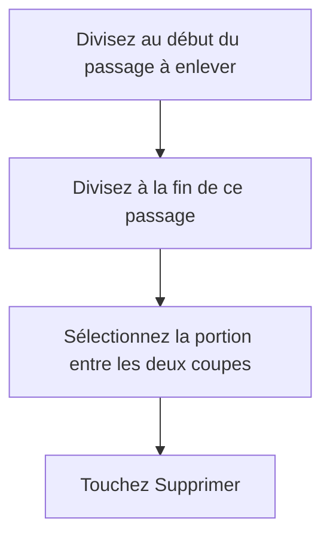
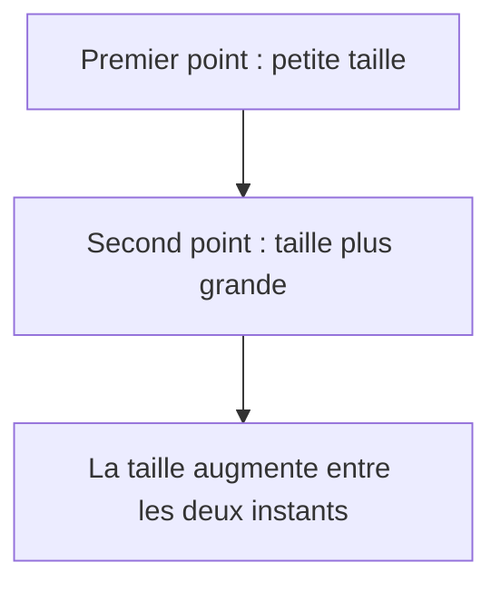
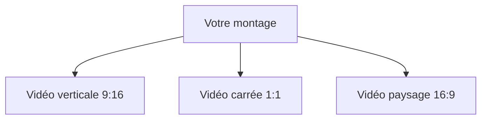

# Utiliser CutFuze

Choisissez un sujet pour retrouver les commandes dont vous avez besoin. Pour réaliser votre première vidéo, suivez les [premiers pas](Tutorial.fr.md).

## Comment ajouter mes photos et vidéos ?

1. Dans la bibliothèque, touchez **Nouveau projet**.
2. Dans l’éditeur, ouvrez **Médias → Photos et vidéos**.
3. Choisissez vos images et vos vidéos, puis confirmez.
4. Mettez-les dans l’ordre souhaité dans la liste d’import.
5. Choisissez **À la suite du montage**, puis **Ajouter**.

Votre premier plan apparaît dans l’aperçu. Les suivants se trouvent à sa suite dans la timeline, la zone de montage sous la vidéo.

Pour un média enregistré dans Fichiers, choisissez **Médias → Fichiers**. **Ressources locales** permet de réutiliser un média déjà ajouté au projet.

Vous voulez placer une image au-dessus de la vidéo ? Utilisez **Overlay → Photos et vidéos**, puis **En superposition**. Cette destination nécessite une scène active.

Un média conservé dans iCloud peut prendre un peu de temps à télécharger. Attendez la fin de l’import avant de continuer.

## Comment me repérer dans l’éditeur ?

**En haut**, vous pouvez revenir à vos projets, annuler une action ou exporter votre vidéo.

**Dans l’aperçu**, vous voyez le résultat à l’instant choisi. Le bouton de lecture sous la vidéo permet de regarder le montage. Le temps affiché indique où vous vous trouvez.

**Dans la timeline**, les rectangles représentent les vidéos, photos, textes et sons. Faites défiler les pistes pour avancer ou reculer. Le trait vertical indique l’instant affiché dans l’aperçu : c’est le curseur de lecture.

**En bas**, les outils changent selon l’élément sélectionné. Touchez un texte pour retrouver **Modifier**, **Style** et **Police** ; touchez un audio pour retrouver **Volume** et **Fondu**.

Besoin de place ? Faites glisser la petite barre entre l’aperçu et la timeline. Faites défiler les outils horizontalement pour découvrir les commandes restantes, et les panneaux verticalement pour atteindre les réglages du bas.

**Scénario** est une autre façon d’organiser les scènes. Vous pouvez rester dans la timeline pour les opérations courantes. Les changements réalisés dans une vue se retrouvent dans l’autre.

## Comment raccourcir ou couper une vidéo ?

Pour garder uniquement le passage intéressant :

1. Touchez le segment vidéo dans la timeline.
2. Attrapez sa poignée de début et faites-la glisser vers la droite.
3. Attrapez celle de fin et faites-la glisser vers la gauche.
4. Lisez le passage pour vérifier les nouvelles limites.

Si les poignées sont difficiles à attraper, agrandissez la timeline avec le bouton **+** de zoom. Vous pouvez rallonger le segment jusqu’aux limites de la vidéo d’origine.

Pour couper en deux, placez le curseur au point voulu, sélectionnez le segment et touchez **Diviser**. Le curseur doit se trouver à l’intérieur du segment, pas exactement au début ou à la fin.

Pour enlever une portion au milieu :

Relisez le résultat. Si d’autres éléments ou la scène occupent encore cet intervalle, ajustez aussi leurs positions ou leur durée. Supprimer un élément ne raccourcit pas forcément toutes les pistes.

Une erreur ? Touchez la flèche **Annuler** en haut.

## Comment déplacer un élément ou changer sa durée ?

Dans la timeline, sélectionnez le segment, puis faites-le glisser vers l’instant souhaité. Pour changer sa durée, déplacez une poignée de début ou de fin.

L’**aimantation** facilite l’alignement avec une coupe ou un repère. Désactivez-la pour placer un élément librement. Le zoom permet un placement plus précis.

Dans l’aperçu, **sélectionnez d’abord l’objet**, puis faites glisser l’objet encadré. Les contrôles du cadre servent à changer sa taille et sa rotation. Pour modifier un texte posé sur une vidéo, vérifiez que le cadre entoure bien le texte.

**Dupliquer** crée un autre exemplaire. La **poubelle rouge** supprime l’élément. Pour changer sa photo ou sa vidéo, utilisez **Remplacer** ou **Plus → Remplacer le média** selon les outils affichés.

## Comment recadrer et superposer des images ?

Sélectionnez le plan, puis ouvrez **Effets → Transformer**.

**Ajuster** montre toute l’image. Des bandes peuvent apparaître si sa forme diffère de celle de la vidéo. **Remplir** couvre tout le cadre, mais peut couper les bords. Ajustez ensuite la position et l’échelle pour garder le sujet visible.

Pour rendre une image partiellement transparente, utilisez **Opacité**. Pour n’en afficher qu’une partie, utilisez **Masque**.

**Détourer** retire le fond autour d’une personne sur les médias compatibles. Regardez les contours pendant la lecture, particulièrement autour des cheveux et lorsque le sujet bouge.

Pour un élément graphique, ouvrez **Overlay → Forme**, choisissez une forme et placez-la dans l’aperçu. Sa largeur et sa hauteur peuvent être modifiées séparément.

## Comment ajouter et personnaliser du texte ?

1. Retrouvez les outils d’ajout et ouvrez **Texte → Ajouter du texte**.
2. Sélectionnez le nouveau texte et touchez **Modifier**.
3. Saisissez votre texte, puis quittez le clavier avec **Terminé**.
4. Ouvrez **Style** pour régler sa taille, sa couleur, son contour et son fond.
5. Ouvrez **Police** pour choisir une autre écriture.

La taille se règle en points, avec **−** et **+**. Pour déplacer ou redimensionner le texte dans la vidéo, sélectionnez-le dans l’aperçu avant d’utiliser son cadre.

Pour un fond coloré, choisissez une couleur et augmentez son opacité. Vous pouvez utiliser un rectangle, un arrondi, une pilule, un nuage, une étoile ou un cœur. Préférez une forme simple pour plusieurs lignes.

Conseil : regardez le texte sur plusieurs images. Un texte lisible sur une image sombre peut se perdre sur un ciel clair. Un contour ou un fond préserve sa lisibilité.

## Comment créer et corriger les sous-titres ?

Si votre vidéo contient une voix :

1. Ouvrez **Texte → Sous-titres automatiques**.
2. Choisissez la vidéo ou l’audio à transcrire.
3. Indiquez la langue qui est réellement parlée.
4. Touchez **Générer les sous-titres** et attendez leur apparition.

Vous pouvez choisir une autre langue de sortie lorsqu’une traduction est disponible. La langue des menus est indépendante de celle de votre vidéo.

Pour corriger un sous-titre, sélectionnez-le et touchez **Modifier**. Choisissez sa ligne dans la liste, corrigez le texte en haut et touchez **Enregistrer**. Les onglets **Style**, **Police** et **Effets** personnalisent son apparence.

**Ce sous-titre** limite les réglages au segment choisi. **Toute la piste** permet d’harmoniser le style ou de déplacer les sous-titres ensemble. Repassez à **Ce sous-titre** pour une exception.

La **relecture Apple Intelligence** peut proposer des corrections. Choisissez un segment ou toute la piste, puis écoutez les passages et vérifiez les propositions avant de les appliquer. Cette fonction corrige l’écriture : elle ne vérifie pas que les mots correspondent exactement à la voix. Elle nécessite un appareil compatible et Apple Intelligence activé.

Vous avez déjà des sous-titres ? Utilisez **Texte → Importer un SRT**.

## Comment ajouter de la musique ou une voix off ?

Ouvrez **Audio → Importer un audio** et choisissez votre fichier dans Fichiers. **Audios déjà importés** retrouve les sons présents dans le projet.

Sélectionnez le son pour régler son **Volume**, sa **Vitesse** ou ses **Fondus**. Les fondus rendent le début et la fin moins brusques. La vitesse modifie aussi la durée : vérifiez ensuite où le son commence et se termine.

Pour enregistrer votre voix :

1. Placez le curseur à l’endroit voulu et ouvrez **Audio → Voix off**.
2. Autorisez le microphone si l’appareil vous le demande.
3. Lancez l’enregistrement et attendez le décompte.
4. Arrêtez la prise, puis choisissez **Utiliser cette prise**.

Utilisez un casque si vous écoutez le montage pendant l’enregistrement. Pour créer une voix à partir d’un texte, choisissez **Audio → Synthèse vocale**, puis une voix proposée.

Écoutez le résultat : baissez la musique si elle couvre les paroles. La courbe de volume, accessible depuis **Volume**, permet de baisser le son pendant la voix et de le remonter ensuite.

## Comment animer un texte, une image ou un son ?

Commencez par les animations proposées dans **Animation**. **Entrée** fait apparaître l’élément, **Sortie** le fait disparaître et **Boucle** crée un mouvement répété.

Pour personnaliser le mouvement, ouvrez l’éditeur de points. Un point associe une valeur à un instant : par exemple une petite taille au début, puis une taille plus grande une seconde plus tard. La courbe montre l’évolution entre les deux.

1. Choisissez le réglage à animer : position, taille, rotation ou opacité.
2. Placez-vous à un instant, réglez sa valeur et ajoutez un point.
3. Avancez dans le segment, changez la valeur et ajoutez un autre point.
4. Sélectionnez le second point pour choisir comment le mouvement arrive jusqu’à lui.

L’**interpolation** désigne cette progression : linéaire pour un changement régulier, accélération ou décélération pour un mouvement plus souple. Le premier point n’a pas d’arrivée depuis un point précédent.

Si rien ne bouge, vérifiez que les deux points ont des valeurs différentes. Faites glisser la barre sous l’aperçu pour agrandir les réglages. Le même principe permet de faire varier le volume d’un son.

## Comment ajouter un effet et voir son résultat ?

1. Sélectionnez l’élément à modifier.
2. Ouvrez **Effets** et choisissez **Beauté**, **Géométrie**, **Créatif** ou **Lumière**.
3. Choisissez un effet et ajustez ses réglages.
4. Lisez la séquence dans son éditeur pour voir le résultat en mouvement.
5. Comparez avec l’original, puis confirmez.

Quelques idées : le **Néon** pour un contour lumineux, la **Traînée fantôme** sur un sujet en mouvement ou le **Stop-motion** pour un mouvement saccadé. Le **Scan temporel** fige progressivement l’image dans la direction choisie.

Pour l’**Écriture tracée**, ouvrez la zone de dessin. Levez le doigt et reprenez ailleurs pour créer plusieurs traits. **Effacer** permet de recommencer ; validez lorsque le tracé vous convient.

Dans **Appliqués**, retrouvez les effets du segment, ouvrez leurs réglages, désactivez-les temporairement ou supprimez-les avec la poubelle rouge. Consulter une catégorie n’applique pas un effet à elle seule.

Un effet semble absent ? Vérifiez son intensité et sa période d’application. Certains effets sont plus visibles sur une vidéo en mouvement que sur un texte ou une photo. Plusieurs effets complexes peuvent ralentir la lecture.

## Comment changer le format et exporter ?

Ouvrez **Format** dans les outils d’ajout : **9:16** pour une vidéo verticale, **1:1** pour un carré ou **16:9** pour une vidéo paysage.

Le montage et le son restent communs aux formats. Ajustez le cadrage et la position des textes pour chaque sortie avec les réglages propres au format. Vérifiez les autres sorties après vos changements.

1. Touchez **Exporter** en haut de l’éditeur.
2. Sélectionnez le ou les formats souhaités.
3. Commencez par **Équilibré** et **1080p**. **Compact** donne un fichier plus léger ; **Haute fidélité** préserve davantage de détails.
4. Choisissez H.264 pour privilégier la compatibilité ; HEVC permet généralement des fichiers plus petits.
5. Touchez **Lancer l’export**, puis attendez **Terminé**.
6. Lisez le résultat avant de le partager ou de l’enregistrer dans Photos.

La taille affichée est une estimation. Augmenter la résolution ne rend pas plus détaillée une vidéo de départ peu nette.

L’appareil peut poursuivre un traitement en arrière-plan, mais il peut aussi l’interrompre. Suivez le message affiché ; gardez CutFuze ouvert si demandé et évitez de forcer sa fermeture pendant l’opération.

Pour une copie que vous pourrez modifier plus tard ou transférer, choisissez **Exporter le projet complet**. La vidéo exportée sert au partage ; le fichier de projet conserve les éléments du montage. **SRT** et **VTT** exportent les sous-titres seuls.

## Besoin d’un coup de main ?

**Je ne trouve pas un outil.** Vérifiez le segment sélectionné. Faites défiler la barre du bas. Les outils d’ajout apparaissent lorsqu’aucun segment n’est sélectionné.

**Le clavier cache les réglages.** Touchez **Terminé**, puis faites défiler le panneau.

**Je ne vois pas mon texte.** Vérifiez sa durée, sa position, sa couleur et son opacité. Placez le curseur à un instant où le texte doit apparaître.

**Toute la piste de sous-titres change.** Choisissez **Ce sous-titre** avant de modifier un seul segment.

**Je ne peux pas couper.** Placez le curseur à l’intérieur du segment, puis touchez **Diviser**.

**Les sous-titres ne se génèrent pas.** Vérifiez que le média contient une voix audible et que la langue est correcte. Certaines fonctions nécessitent des ressources que l’appareil doit télécharger.

**L’export prend du temps.** Essayez une résolution plus basse ou moins d’effets complexes, vérifiez l’espace disponible et suivez le message affiché.
