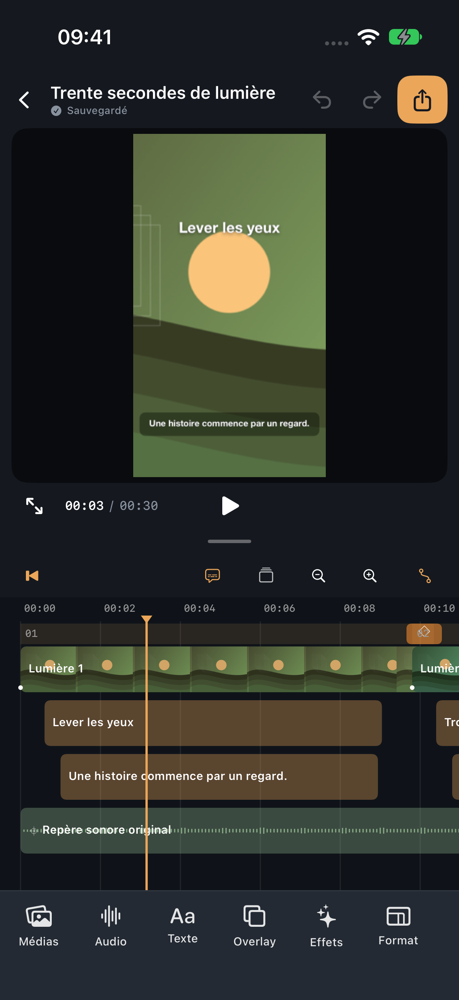
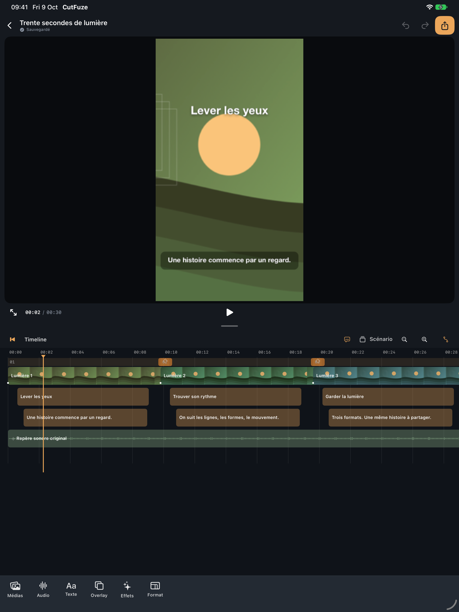
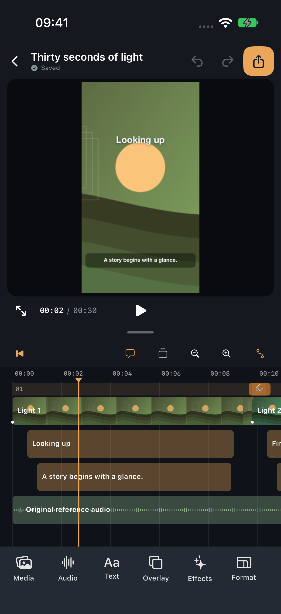

# CutFuze

[Français](#français) · [English](#english)

## Français

CutFuze est un éditeur vidéo natif pour **iPhone et iPad**, sans compte, avec un montage traité localement. Une timeline multipiste, des outils contextuels et un aperçu redimensionnable permettent de travailler directement sur les vidéos, photos, textes, sous-titres et overlays.

Un montage, plusieurs sorties : **9:16, 1:1 et 16:9** partagent les coupes, les textes et le son, avec un cadrage et une mise en page propres à chaque format. **Scénario** reste accessible comme seconde représentation du même document. L’interface suit la langue de l’appareil, en français ou en anglais.

### En images

<p>
  
  
</p>

Captures réelles sur simulateurs, réalisées le **9 octobre 2026** avec les médias originaux du projet exemple. Elles illustrent l’éditeur à cette date ; les ajouts récents sont décrits ci-dessous. [Galerie iPhone](Docs/AppStore/Screenshots-iPhone-6.1-6.3-2026-10-09/README.md) · [Galerie iPad et provenance](Docs/AppStore/Screenshots-2026-10-09/README.md).

### Documentation et tutoriel

[Guide utilisateur détaillé](Docs/UserGuide.fr.md) · [Tutoriel : votre premier montage](Docs/Tutorial.fr.md)

L’aide répond aux questions courantes sur l’import, la timeline, les textes, les sous-titres, le son, les effets et l’export. Les premiers pas accompagnent la création d’une vidéo en six étapes courtes, avec captures et schémas.

Dans l’app, ouvrir **Aide et tutoriel** depuis le bouton **?** de la bibliothèque ou de l’éditeur, ou depuis les réglages. **Aide** présente les sujets à consulter ; **Premiers pas** affiche une étape à la fois et garde votre place lorsque vous revenez au montage. Le contenu fonctionne hors ligne et suit la langue de l’appareil. Après une modification des guides, exécuter `sh Scripts/sync-help.sh` pour mettre à jour leurs copies embarquées avant compilation.

### Fonctionnalités

- **Timeline** : import Photos/Fichiers, sélection, déplacement, trim, division, duplication, snapping, zoom temporel, undo/redo et transitions entre scènes. Miniatures vidéo et formes d’onde audio servent de repères.
- **Aperçu interactif** : sélectionner un élément avant de le déplacer, redimensionner ou faire pivoter. Cadrage, masque, opacité et transformation restent liés à la sélection.
- **Texte et sous-titres** : polices expressives, taille en points, couleurs, contour et fonds colorés de plusieurs formes. Réglages par segment ou pour toute la piste ; transcription automatique selon les capacités du système.
- **Relecture Apple Intelligence** : propositions par segment ou par piste, regroupement des phrases et redistribution sur les découpes existantes, écoute du segment et validation avant application. Nécessite un appareil compatible et un modèle disponible ; la relecture du texte ne vérifie pas sa fidélité à l’audio.
- **Audio et overlays** : import et réutilisation de médias, musique, voix off, synthèse vocale, volume, fondus, vitesse et courbes de volume. Sélecteur de formes et redimensionnement indépendant en largeur et hauteur.
- **Courbes** : points de contrôle, interpolation et aperçu redimensionnable. L’éditeur d’effets permet de lire la séquence et de comparer avec l’original. Les effets appliqués sont regroupés avec réglages, activation et suppression.
- **Effets créatifs** : néon à halo réglable, rêve, reflet lumineux, déformation liquide, grand-angle pulsé, traînée fantôme, stop-motion, flou filé, trame pop, bichromie et bords déchirés. L’écriture tracée accepte plusieurs traits séparés et un effacement annulable. Le **Scan temporel** fige progressivement l’image avec quatre directions, une durée, un départ au curseur et une ligne masquable.
- **Export** : MP4 H.264/HEVC, formats multiples, dimensions, cadence, profils qualité/taille et débit avancé. Les projets `.cutlabproject` transportent le document et ses médias dans une copie autonome.

### Ouvrir et lancer

1. Ouvrir `CutFuze.xcodeproj` avec **Xcode 27 ou ultérieur**. Le projet cible actuellement **iOS/iPadOS 26.0**.
2. Choisir le schéma partagé **CutFuze** et un simulateur iPhone ou iPad compatible, puis lancer l’application.
3. Sur appareil physique, configurer votre équipe dans **Signing & Capabilities** et vérifier le Bundle ID. Les identifiants de développement du dépôt ne constituent pas une configuration de distribution.
4. Dans la bibliothèque, ouvrir le projet exemple : une histoire originale de 30 secondes, avec trois scènes, titres, sous-titres et son de référence. Aucun accès Photos n’est nécessaire.

Aucune dépendance tierce à télécharger : SwiftUI/UIKit, AVFoundation, Core Image, Core Text, Vision, Speech, Foundation Models et CryptoKit sont fournis par Apple. Certaines API média compilent avec des avertissements de dépréciation sous le SDK 27.

### Tests et limites

Tests du modèle sur simulateur :

```sh
xcrun simctl list devices available
xcodebuild -project CutFuze.xcodeproj -scheme CutFuze \
  -destination 'platform=iOS Simulator,id=SIMULATOR_UDID' \
  -parallel-testing-enabled NO -only-testing:CutFuzeTests/CoreTests test
```

Validation complète avec compilation, tests et extraction des pièces jointes :

```sh
Scripts/validate.sh SIMULATOR_UDID
```

Remplacer `SIMULATOR_UDID` par l’identifiant d’un simulateur dédié : les parcours UI créent des projets de démonstration. Les tests média produisent et relisent de vrais MP4.

Lors de l’ajout du Scan temporel le **11 octobre 2026**, 73 tests du modèle, les tests ciblés de rendu/export après coupe et le parcours UI du nouvel effet sur simulateurs iPhone/iPad ont réussi. Ce résultat ne couvre pas toute l’application sur tous les appareils. Une installation sur appareil physique n’est pas une recette exhaustive.

Les effets temporels peuvent ralentir l’aperçu et l’export ; aucune cadence temps réel universelle n’est garantie. Speech et Apple Intelligence dépendent de l’appareil, des langues et des ressources système. L’export est SDR ; la prise en charge et les performances 4K/HEVC doivent être vérifiées sur les appareils visés. Les profils qualité/taille utilisent la qualité constante si l’encodeur la prend en charge, sinon un débit adapté ; ce ne sont pas des presets FFmpeg/CRF.

Les rapports historiques [ValidationReport](Docs/ValidationReport.md), [FeatureMatrix](Docs/FeatureMatrix.md) et [KnownLimitations](Docs/KnownLimitations.md) détaillent leurs périmètres datés, sans remplacer une recette de la version actuelle. Le [cahier produit](Docs/ProductSpec.md) décrit les objectifs, pas une déclaration de conformité intégrale ou de disponibilité App Store.

### Architecture et confidentialité

- `CutFuze/Core/` : document versionné, temps rationnel, historique, retiming, sous-titres et projets portables.
- `CutFuze/Media/` : import durable, miniatures, waveforms, rendu partagé entre aperçu/export, mixage et encodage.
- `CutFuze/Services/` : transcription, relecture locale, voix, modèles et analyses Vision.
- `CutFuze/UI/` : bibliothèque, éditeur, timeline, outils contextuels et éditeurs de courbes.
- `CutFuzeTests/`, `CutFuzeUITests/` : modèle, rendu, transport et parcours d’interface.
- `Docs/` : conception, preuves de tests, confidentialité et ressources de publication.

Aucun compte, serveur applicatif, analytics publicitaire ou SDK distant n’est intégré. Les fournisseurs Photos/Fichiers et le téléchargement des ressources système peuvent néanmoins nécessiter du réseau. Les médias de démonstration sont originaux.

### Démonstration portable

[Projet exemple](Docs/Evidence/Demo/Trente-secondes.cutlabproject) · [Vidéo verticale](Docs/Evidence/Demo/9x16.mp4) · [Vidéo carrée](Docs/Evidence/Demo/1x1.mp4) · [Vidéo paysage](Docs/Evidence/Demo/16x9.mp4).

---

## English

CutFuze is a native video editor for **iPhone and iPad**, with no account requirement and local editing. A multitrack timeline, contextual tools and a resizable preview let you work directly with video, photos, text, captions and overlays.

One edit, several outputs: **9:16, 1:1 and 16:9** share cuts, text and audio while allowing format-specific framing and layout. **Story** remains available as a second view of the same document. The interface follows the device language, in French or English.

### Screenshots

<p>
  
  
</p>

Genuine simulator screenshots captured on **October 9, 2026**, using the original demo project's media. They show the editor at that date; recent additions are described below. [iPhone gallery](Docs/AppStore/Screenshots-iPhone-6.1-6.3-2026-10-09/README.md) · [iPad gallery and provenance](Docs/AppStore/Screenshots-2026-10-09/README.md).

### Documentation and tutorial

[Detailed user guide](Docs/UserGuide.en.md) · [Tutorial: your first edit](Docs/Tutorial.en.md)

Help answers common questions about importing, timeline editing, text, captions, sound, effects and export. First steps walks through creating a video in six short steps with screenshots and diagrams.

In the app, open **Help and tutorial** using the **?** button in the library or editor, or through Settings. **Help** lists topics to consult; **First steps** shows one step at a time and keeps your place when you return to editing. Content works offline and follows the device language. After editing the guides, run `sh Scripts/sync-help.sh` to refresh the bundled copies before building.

### Features

- **Timeline**: Photos/Files import, selection, moving, trimming, splitting, duplication, snapping, temporal zoom, undo/redo and scene transitions. Video thumbnails and audio waveforms provide visual references.
- **Interactive preview**: select an element before moving, resizing or rotating it. Framing, mask, opacity and transform controls remain tied to the selection.
- **Text and captions**: expressive fonts, point-based sizing, colors, outlines and colored backgrounds with several shapes. Settings for one segment or the whole track; automatic transcription depends on system capabilities.
- **Apple Intelligence proofreading**: review individual captions or a whole track, reassemble phrases and distribute corrections across existing timing boundaries, listen to segments and accept proposals before applying them. Requires an eligible device and an available model; text proofreading does not check accuracy against the audio.
- **Audio and overlays**: import and reuse media, music, voice-over recording, text-to-speech, volume, fades, speed and volume curves. Shape picker and independent width/height resizing.
- **Curves**: control points, interpolation and a resizable preview. The effect editor supports sequence playback and comparison with the original. Applied effects are grouped with settings, enable/disable and deletion controls.
- **Creative effects**: neon with adjustable glow spread, dream, light sweep, liquid distortion, wide-angle pulse, ghost trail, stop motion, directional blur, pop halftone, duotone and torn edges. Write-on supports disconnected strokes and undoable clearing. **Time scan** progressively freezes the image, with four directions, sweep duration, a playhead-based start and an optional scan line.
- **Export**: H.264/HEVC MP4, multiple formats, dimensions, frame rate, quality/size profiles and advanced bitrate control. Portable `.cutlabproject` files contain the document and its media as a self-contained copy.

### Build and run

1. Open `CutFuze.xcodeproj` in **Xcode 27 or later**. The project currently targets **iOS/iPadOS 26.0**.
2. Select the shared **CutFuze** scheme and a compatible iPhone or iPad simulator, then run the app.
3. For a physical device, configure your own team in **Signing & Capabilities** and check the Bundle ID. The repository's development identifiers are not a distribution setup.
4. Open the sample project from the library: an original 30-second story with three scenes, titles, captions and reference audio. No Photos access is required.

No third-party dependencies need downloading. SwiftUI/UIKit, AVFoundation, Core Image, Core Text, Vision, Speech, Foundation Models and CryptoKit are provided by Apple. Some media APIs produce deprecation warnings under SDK 27.

### Testing and limitations

Model tests on a simulator:

```sh
xcrun simctl list devices available
xcodebuild -project CutFuze.xcodeproj -scheme CutFuze \
  -destination 'platform=iOS Simulator,id=SIMULATOR_UDID' \
  -parallel-testing-enabled NO -only-testing:CutFuzeTests/CoreTests test
```

Full build, test run and attachment export:

```sh
Scripts/validate.sh SIMULATOR_UDID
```

Replace `SIMULATOR_UDID` with the identifier of a dedicated simulator: UI journeys create demo projects. Media tests generate and decode real MP4 files.

During the Time scan implementation on **October 11, 2026**, 73 model tests, targeted rendering/export-after-split tests and the new effect's UI journey on iPhone/iPad simulators passed. This does not qualify every feature on every device. Installing the app on a physical device is not an exhaustive interaction test.

Temporal effects can slow preview and export; universal real-time playback is not guaranteed. Speech and Apple Intelligence availability depends on the device, languages and system resources. Export is SDR; 4K/HEVC support and performance need qualification on target devices. Quality/size profiles use constant quality when supported by the encoder, otherwise an adapted bitrate; they are not FFmpeg/CRF presets.

Historical [ValidationReport](Docs/ValidationReport.md), [FeatureMatrix](Docs/FeatureMatrix.md) and [KnownLimitations](Docs/KnownLimitations.md) documents record dated scopes and do not replace testing the current version. The [product specification](Docs/ProductSpec.md) describes goals, not a claim of full compliance or App Store availability.

### Architecture and privacy

- `CutFuze/Core/`: versioned document, rational time, history, retiming, captions and portable projects.
- `CutFuze/Media/`: durable imports, thumbnails, waveforms, shared preview/export rendering, mixing and encoding.
- `CutFuze/Services/`: transcription, local proofreading, voice, templates and Vision analysis.
- `CutFuze/UI/`: library, editor, timeline, contextual tools and curve editors.
- `CutFuzeTests/`, `CutFuzeUITests/`: model, rendering, transport and UI journeys.
- `Docs/`: design, test evidence, privacy and publication resources.

No account, application server, advertising analytics or remote SDK is integrated. Photos/Files providers and system resource downloads may still require a network connection. Demo media is original.

### Portable demo

[Sample project](Docs/Evidence/Demo/Trente-secondes.cutlabproject) · [Portrait video](Docs/Evidence/Demo/9x16.mp4) · [Square video](Docs/Evidence/Demo/1x1.mp4) · [Landscape video](Docs/Evidence/Demo/16x9.mp4).
